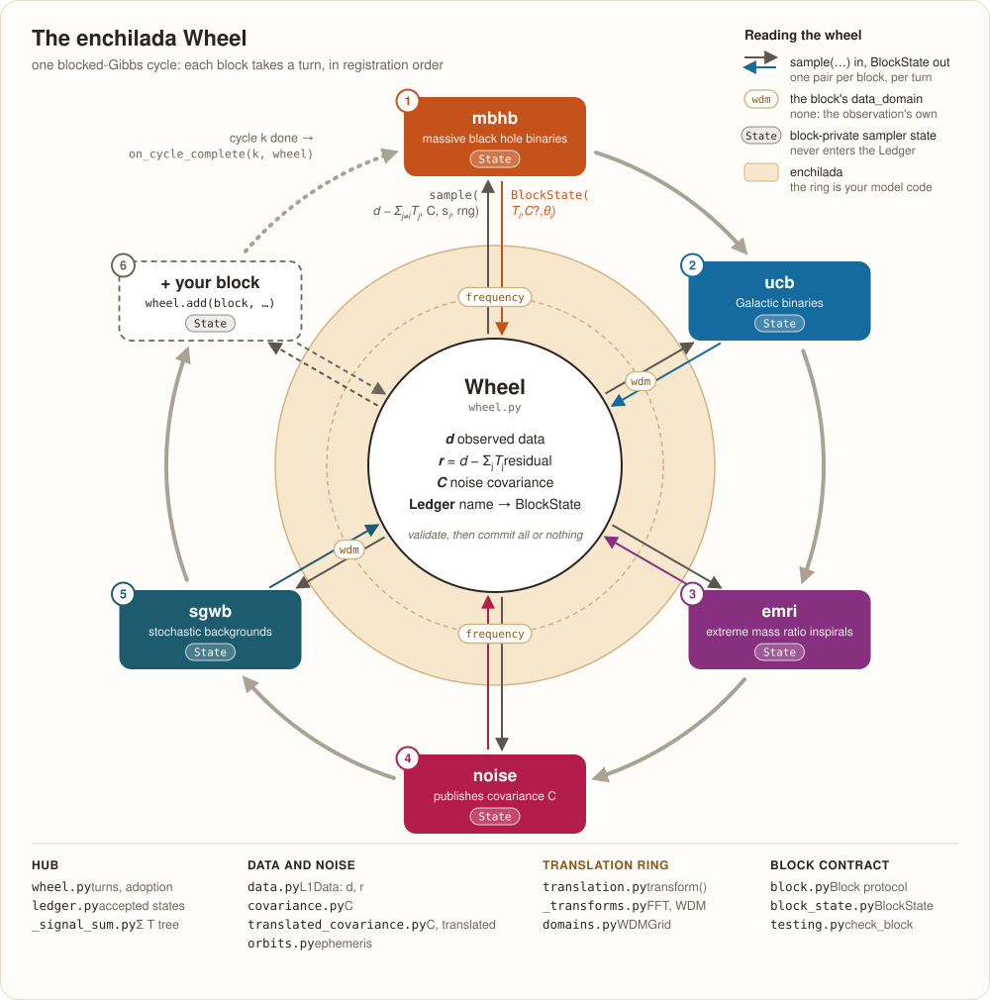

# enchilada

[](https://github.com/AaronDJohnson/enchilada/actions/workflows/ci.yml)
[](LICENSE)

Blocked-Gibbs global-fit orchestration for LISA.

*The whole enchilada*: a global fit infers every source population and the
instrument noise **together**, because none of them can be measured cleanly
without the others. This is the layer that makes that one joint fit out of
many separately-owned pieces.

A `Wheel` owns pristine L1 observations, a working residual, optional noise
covariance, and a `Ledger` containing each block's accepted `BlockState`:
an optional signal template, an optional covariance, and physical parameters.
Each block owns its sampler continuation state and diagnostics. The Wheel supplies
the data minus all other blocks' signals and the block's accepted physical state,
then validates and records the returned estimate.
Waveforms, likelihoods, and prior/conditional sampling remain model code.



*Blocks take turns clockwise, in registration order. enchilada owns the hub, the
spokes, and the translation ring; everything on the ring is model code.*

## Install

Requires Python ≥ 3.12 (floor set by lisaorbits).

```sh
pip install enchilada      # or: uv add enchilada
```

To work on enchilada itself, clone it and use [uv](https://docs.astral.sh/uv/):

```sh
git clone https://github.com/AaronDJohnson/enchilada.git
cd enchilada
uv sync
```

or with pip: `pip install -e .`

The core package depends only on NumPy (`>=1.26.4`). GBGPU, Eryn, and LISA Analysis Tools
are confined to the optional galactic-binary example. Installing enchilada or
any of its extras does not install them; running that example requires the
separate `examples/requirements-gb.txt` installation described below.

Loading tabulated spacecraft
ephemerides (`enchilada.orbits.NumericOrbit`) needs the extra:

```sh
uv sync --extra numeric-orbits   # adds h5py, scipy, lisaorbits

# For the notebooks, install both extras together:
uv sync --extra numeric-orbits --extra examples
uv run --no-sync jupyter lab examples/demo.ipynb
```

## Quickstart

```sh
uv run --no-sync python examples/demo.py
```

runs three Gibbs cycles over two zero-signal `EchoBlock`s on synthetic data —
enough to watch the Wheel hand each block its residual. The whole thing is:

<!-- runnable -->
```python
import numpy as np
from enchilada import BlockState, L1Data, Wheel
from enchilada.testing import EchoBlock

rng = np.random.default_rng(0)
num_time_samples = 1024
channel_names = ("A", "E", "T")

# One frozen object holds the TDI arrays and the run settings everyone shares.
observed = L1Data(
    {ch: rng.standard_normal(num_time_samples) for ch in channel_names},
    sample_rate_hz=0.1,
    tdi_generation="2.0",
    physical_observable="fractional_frequency",
)  # num_time_samples is read off the arrays; start_time_gps defaults to 0.0

ucb = EchoBlock(name="ucb")
mbhb = EchoBlock(name="mbhb")

wheel = Wheel(observed_data=observed)
wheel.add(
    block_to_register=ucb,
    initial_block_state=BlockState(),
)
wheel.add(
    block_to_register=mbhb,
    initial_block_state=BlockState(),
)
wheel.run(num_cycles=3)

wheel.residual()  # the running residual: observed minus every block's template
# The diagnostic counter belongs to the block.
assert ucb.state.num_sample_calls == 3
```

[`examples/demo.ipynb`](https://github.com/AaronDJohnson/enchilada/blob/main/examples/demo.ipynb) is the same walkthrough with
commentary, plus the `L1Data` long/short name aliases (`Tobs`, `fs`, `dt`,
...), the typo catcher, and attaching a constellation ephemeris. For a real
(toy) sampler — two conjugate-Gibbs source blocks plus a sampled
white-noise block, converging to known truth — run
[`examples/toy_fit.py`](https://github.com/AaronDJohnson/enchilada/blob/main/examples/toy_fit.py).

To write your own block, work through the
[Block authoring tutorial](examples/create_block.ipynb). It builds a Metropolis
sampler from scratch, starts its main campaign at a known injection, checks its
posterior, demonstrates continuation and domain selection, and adds a noise-only
block using the same interface.

For a **real LISA source class**, [`examples/gb_block_eryn.ipynb`](https://github.com/AaronDJohnson/enchilada/blob/main/examples/gb_block_eryn.ipynb)
fits an injected galactic binary through the Wheel using GBGPU waveforms, an
Eryn sampler with block-owned continuation state, and a fixed LISA noise PSD from LISA
Analysis Tools. Everything that is *not* enchilada lives in
[`examples/gb_model.py`](https://github.com/AaronDJohnson/enchilada/blob/main/examples/gb_model.py), so the notebook shows only the
enchilada touchpoints. That example needs an external LISA stack — none of it
an enchilada dependency, so it is not exercised by CI:

```sh
uv sync --extra numeric-orbits --extra examples
uv pip install -r examples/requirements-gb.txt
uv run --no-sync jupyter lab examples/gb_block_eryn.ipynb
```

Run these commands from the checkout root, in this order. Sync the project extras
first, then install the external stack: a later exact `uv sync` removes packages
that are outside the project lockfile. `--no-sync` launches Jupyter in that prepared
environment. The example requirements constrain NumPy to `<2.4`: released Eryn
1.2.6 calls `numpy.in1d`, which was [removed in NumPy 2.4](https://numpy.org/devdocs/release/2.4.0-notes.html#removed-numpy-in1d).
This constraint applies only to the optional example environment.

Every piece of it ships wheels, so nothing compiles. But `gbgpu` and
`lisaanalysistools` publish *no* sdist, which fixes the example's window
narrower than enchilada's own: **Python 3.12–3.13, on Linux or Apple-silicon
macOS**. Intel macOS, Windows, and 3.14 have no wheels, and pip reports that as
`No matching distribution found` rather than a build error — see the header of
[`examples/requirements-gb.txt`](https://github.com/AaronDJohnson/enchilada/blob/main/examples/requirements-gb.txt)
for the full matrix. Wheel availability and dependency resolution do not establish
native GBGPU runtime validation. Its outputs are not committed; run it to populate them.

## Plugging in your sampler

Implement the `Block` protocol:

- `name`: unique within a Wheel.
- `sample(conditional_residual, covariance, current_block_state, *, rng) -> BlockState`:
  sample against the data minus every other block's latest signal and return
  the new physical estimate.

`conditional_residual` is an `L1Data`; `covariance` is a `Covariance` on the same
grid as `conditional_residual`, or `None`; and `current_block_state` is that block's
previous accepted `BlockState`.
Use the supplied NumPy RNG for draws. Wheel commits its progress only with a valid
returned state. Keep walkers, adaptation, counters, diagnostics, and external sampler
RNG state on the block instance, for example in a nested dataclass with typed fields:

```python
from dataclasses import dataclass

class MyBlock:
    @dataclass
    class State:
        num_sample_calls: int = 0
        log_likelihood: float | None = None

    def __init__(self, name: str):
        self.name = name
        self.state = self.State()

    # Implement sample(...) using self.state for sampler continuation.
```

`State` is defined by each block; it is not an enchilada interface. Use separate
block instances for independent campaigns. Wheel neither copies nor rolls back
this block-local state.

A `BlockState` publishes exactly three fields:

| Field | Contents |
| --- | --- |
| `template` | Optional dictionary of channel arrays containing the **sum** of this block's modeled signals. `None` means zero signal. |
| `covariance` | Optional `Covariance`; `None` means no covariance publication. |
| `parameters` | Physical model values, such as amplitudes, source counts, or noise levels; defaults to an empty dictionary. |

Each return replaces the block's previous published snapshot. A missing template
removes any signal that block previously published. A zero-source or diagnostic
block can return `BlockState()`;
`conditional_residual.zero_block_state(parameters=...)` constructs explicit zero
arrays when they are useful.

For example, after calculating a new amplitude:

```python
self.state.num_sample_calls += 1
self.state.log_likelihood = log_likelihood
new_block_state = conditional_residual.block_state(
    template={"A": amplitude * basis},
    parameters={"amplitude": amplitude},
)
```

One `sample()` call is one block's turn in a Wheel cycle. It may perform many
internal sampler steps. EchoBlock's `state.num_sample_calls` counts calls to
`sample()`, not individual sampler draws; its `state.metadata` holds diagnostics.

Published parameters must support deep copying. Keep open files, processes, GPU
resources, and sampler history on the block or in an external sink, outside
`BlockState`. A returned `L1Data` is rejected: blocks return a `BlockState`.

Every `Wheel.add` requires a complete `initial_block_state`; omitting it or passing
`None` is an error. The application chooses its starting estimate and constructs
the published state before registration. For a known injection:

```python
initial_state = observed.block_state(
    template=injected_signal,
    parameters=injected_parameters,
)
wheel.add(
    block_to_register=signal_block,
    initial_block_state=initial_state,
    data_domain="time",
)
```

Registration validates and adopts this state without calling model code or
consuming Wheel RNG draws. Build `initial_state` with the applicable template,
covariance, and physical parameters. Initialize the block's own `state`
separately so its sampler agrees with that estimate. Optional prior
initialization belongs in application or model setup: use a separate setup RNG
to draw parameters and construct their published state. The Block protocol
requires only `name` and `sample`. The
[Block authoring tutorial](examples/create_block.ipynb) shows a complete
example. Supply signal arrays on the requested block domain and WDM grid, or
the observation grid if no domain is selected. Wheel converts them to the
observation grid for storage. An optional covariance follows the normal
ownership rules and, until covariance translation lands, must be on the
observation grid; a block registered with another domain or WDM grid cannot
carry one (see
[Time, frequency, and WDM translation](#time-frequency-and-wdm-translation)).
Noise-only initial states are supported too.

Wheel validates and defensively copies the published state before adopting it
atomically.
The model must check that its parameters, rendered signal, and algorithm state
agree and that the parameters lie within its prior support; Wheel cannot establish
these scientific conditions. The initial estimate changes the ledger and residual,
while preserving the observations and declared prior. Subsequent calls sample normally; starting
at an injection does not hold its parameters fixed. This initializes one block;
it does not restore a full campaign checkpoint or the Wheel RNG state.

`L1Data` holds channel arrays and observation conventions. Supply noise as an
explicit `Covariance` when constructing Wheel:

```python
from enchilada import Covariance, Wheel

noise = Covariance.from_variance(observed, time_sample_variance=0.25)
wheel = Wheel(
    observed_data=observed,
    initial_covariance=noise,
    random_seed=42,
)
```

With `initial_covariance=None`, Wheel starts without a covariance; a block can
publish one. Convert a one-sided PSD model on frequency-domain data:

```python
spectrum = observed.to_frequency()
spectral = Covariance.from_psd(spectrum, noise_psd_model=model)
```

The model provides `psd(frequencies)` or `psd(frequencies, channel)` returning
finite positive one-sided densities at every rfft bin, including `f = 0`, so
floor it at low frequency. With `dt * rfft(x)` coefficients each bin holds
`C = (Tobs / 2) S`, and `spectral.noise_psd("A", spectrum)` inverts it.

Signal-only, noise-only, and joint signal/noise models all implement `Block`.
A noise-only block publishes covariance directly:

```python
from enchilada import BlockState

new_block_state = BlockState(
    covariance=covariance,
    parameters={"sigma": sigma},
)
```

Publishing covariance makes that block the current covariance owner. The owner
must return its full covariance on every subsequent call, even when unchanged;
omitting it raises `ValueError`. Other blocks may omit `covariance` to keep the
Wheel's current covariance. Joint signal/noise states publish a template and a
covariance in one `BlockState`; validation and adoption are atomic.
`state.with_covariance(covariance)` builds a new state with that covariance.

A `Covariance` is read through its channels. `noise.A`, `noise.E`, `noise.T`
are each channel's own covariance; `noise.AE`, `noise.ET`, `noise.AT` are the
cross terms (or `noise.pair("A", "E")` for names that do not concatenate
cleanly), with `noise.EA` the conjugate transpose of `noise.AE`; an absent
cross term reads as zero. When the channels are exactly X, Y, Z the names
A, E, T and their pairs are derived on demand with the orthonormal LDC
combination A = (Z − X)/√2, E = (X − 2Y + Z)/√6, T = (X + Y + Z)/√3, and
X, Y, Z are derived the same way from A, E, T channels.
`noise.in_basis("AET")` returns the whole derived object. Derivation raises
`ValueError` when the rotated covariance is not numerically positive definite,
as happens when one channel's variance is below float64 roundoff of the others
(T ≪ A at the lowest LISA frequencies).

Each pair is one array on the grid of the data the covariance accompanies.
With channel shape `S` (`(N,)` time, `(N//2 + 1,)` frequency,
`(num_frequency_divisions + 1, num_time_divisions)` WDM), shape `S` means one
value per point (`form="diagonal"`) and shape `S + S` (e.g. `(N, N)` for time
data) a full matrix between points (`form="full"`). Build one from arrays with
`Covariance.like(observed, {"A": var_a, "E": var_e, "T": var_t, "AE": cross})`;
the form is inferred by comparing the array shapes with the data's channel
shape. `noise.noise_variance("A", observed)` gives the per-sample variance from
stationary time covariance or by integrating a frequency covariance. Both it
and `noise_psd` read one channel's own variances; they ignore cross terms such
as `AE` and, for `form="full"`, correlations between points.

The object carries no grid; `noise.check_compatible(observed)` checks channel
order, shape, real/complex kind, and positivity against the data it
accompanies, and Wheel runs it on the initial covariance and on every
covariance a block publishes. Covariance does not yet translate to another
domain or WDM grid; see
[Time, frequency, and WDM translation](#time-frequency-and-wdm-translation).

Wheel uses descriptive arguments at each entry point:

| Entry point | Signature |
| --- | --- |
| Constructor | `Wheel(observed_data, initial_covariance=None, *, random_seed=None)` |
| Register a block | `add(block_to_register, *, initial_block_state, data_domain=None, num_frequency_divisions=None, num_time_divisions=None)` |
| Sample complete cycles | `run(num_cycles, on_cycle_complete=None)` |
| Read a residual | `residual(exclude_block_name=None)` |
| Read a block's signal | `contribution(block_name)` |
| Check a block | `check_block(block_under_test, observed_data, num_cycles=2, *, initial_block_state, initial_covariance=None, random_seed=0)` |

Inspect `wheel.observed_data`, `wheel.working_residual`, `wheel.covariance`, and
`wheel.ledger[name]`; each returns defensive copies of changing data. The orbit is
a shared immutable resource. `wheel.contribution(block_name=name)` returns just the summed
signal, including zero arrays for an omitted contribution, and
`wheel.residual(exclude_block_name=name)` gives that block's conditional data.
Ledger supports `ledger[name]`, iteration over block names, membership checks, and
`len(ledger)`. Use `ledger.snapshot()` for an independent dictionary of all current
published states, including normal dictionary methods such as `items()`. A Ledger
compares by identity; compare arrays and parameters explicitly when comparing
campaigns.

Collect posterior history with `run(num_cycles, on_cycle_complete=callback)`;
Ledger retains current accepted physical states only. The callback receives
`(cycle_index, wheel)` after every block in a cycle has accepted its state. The index is zero-based
and restarts at zero for each `run` call. A partially failed cycle does not invoke
the callback.

A failed call, invalid state, failed copy, or noise ownership warning promoted to
an exception leaves that block's accepted state, covariance, residual, and RNG
unchanged. Earlier successful updates in the same cycle remain committed. Retrying
is explicit; the Wheel does not retry or roll back a whole cycle automatically.
Mutations to a block's own `state` are outside this transaction and remain after
failure. A block that needs rollback must manage its own candidate state and
commit policy.

Before joining a campaign, exercise the protocol against synthetic data:

```python
from enchilada.testing import check_block

check_block(
    block_under_test=MyBlock(name="ucb"),
    observed_data=toy_observed,
    num_cycles=2,
    initial_covariance=None,
    initial_block_state=toy_initial_state,
    random_seed=0,
)
```

This checks registration of the required complete `initial_block_state` and the
requested number of sampling cycles, advancing the supplied block's own state.
Build `toy_initial_state` with the physical parameters, template, and covariance
that `MyBlock.sample` expects, and initialize its sampler state separately.
Supply its template in the domain of `observed_data`; `check_block` does not
select a separate block domain. The optional initial
covariance and random seed configure the test campaign; the defaults are shown
above. Each model must independently validate its
prior, likelihood, and sampler; see the conjugate example in `examples/toy_fit.py`.

## Time, frequency, and WDM translation

Use one wrapper for observations, covariance, and block states:

```python
from enchilada import transform

spectrum = transform(observed, "frequency")
wdm_data = transform(observed, "wdm", num_frequency_divisions=8)
wdm_alternate = transform(observed, "wdm", num_time_divisions=8)
restored = transform(wdm_data, "time")
```

WDM requires both division counts to be positive and even, with
`num_frequency_divisions * num_time_divisions == num_time_samples`. Supply either
count on the first conversion and the other is derived; both can be supplied if
consistent. WDM-to-WDM conversion without new counts reuses the grid.
Each WDM channel contains a real `float64` array of shape
`(num_frequency_divisions + 1, num_time_divisions)`, with zero entries outside
the grid's structural `active_mask`. `L1Data` derives its read-only `wdm_grid`
metadata from this coefficient layout. It is a frozen `WDMGrid` for WDM data
and `None` for time or frequency data; copies preserve the grid. Choose division
counts through `transform` or `Wheel.add(data_domain="wdm", ...)`, rather than
passing `wdm_grid` to `L1Data`.

Time/Fourier transforms use only NumPy. WDM uses the unpublished local `wdm`
checkout and requires Python ≥3.13, NumPy `>=2.1,<3`, and SciPy `>=1.14.1,<2`.
With sibling checkouts, run from the enchilada directory:

```sh
uv sync --python 3.13
uv pip install ../wdm
uv run --no-sync python examples/domain_translation.py
```

Adjust `../wdm` to its local location. Install it after project sync and use
`--no-sync` to preserve the environment. This does not change the core package's
Python ≥3.12 or NumPy-only requirements.
The [WDM integration workflow](.github/workflows/wdm.yml) records the tested
backend version and pinned revision.

Select a representation when registering a block:

```python
wheel.add(
    frequency_block,
    initial_block_state=initial_frequency_state,
    data_domain="frequency",
)
wheel.add(
    wdm_block,
    initial_block_state=initial_wdm_state,
    data_domain="wdm",
    num_frequency_divisions=8,
)
```

Each initial state must contain the physical estimate its block expects, with
any template arrays on that block's selected domain and WDM grid. Wheel converts
the conditional residual and previous signal into the selected representation,
then converts returned outputs back to the canonical observation grid before
atomic adoption. Omitting `data_domain` keeps the default handoff. To convert a
standalone state containing a template, supply its source grid:
`transform(state, "wdm", num_frequency_divisions=8, reference_data=observed)`.
Physical parameters are copied without reinterpretation; block-local sampler
state does not pass through translation.

Covariance translation between representations is not built in. `transform` on
a `Covariance` needs `reference_data` (the data on its current grid), returns an
independent copy for the same domain and grid, and raises `NotImplementedError`
for any other target until a translation layer implements that branch. Until
then, a block registered with a different domain or WDM grid raises
`NotImplementedError` whenever a covariance must cross to or from it: at `add`
for a seed covariance, at `run` while the Wheel holds one, and when it publishes
one. In a campaign that carries covariance, register every block without
`data_domain`.

The [translation notebook](examples/domain_translation.ipynb) walks through the
same API with plots, round-trip checks, and blocks using different domains.

## Conventions and consistency checking

Cross-group runs fail through silently mismatched conventions, so enchilada
makes every convention an explicit, validated part of `L1Data`.

`channel_data` holds the observed or residual arrays. The observation settings are
`channel_names`, `sample_rate_hz`, `num_time_samples`, `start_time_gps`,
`data_domain`, `physical_observable`, `tdi_generation`, and `orbit_ephemeris`.
`wdm_grid` is automatically managed, read-only metadata, not a constructor argument.
Only `channel_data` may be passed positionally; all settings are keyword-only.
`sample_rate_hz`, `tdi_generation`, and `physical_observable` are required.
Omitting `channel_names` (or passing `None`) uses the dictionary's insertion order.
`L1Data.block_state(template=None, *, covariance=None, parameters=None)` builds a
published block state and validates supplied template arrays against this observation
grid. `L1Data.zero_block_state(*, covariance=None, parameters=None)` supplies explicit
zero arrays on the same grid.

Scientific shorthand is part of the API:

| Quantity | Descriptive name | Scientific alias |
| --- | --- | --- |
| Sample rate in Hz | `sample_rate_hz` | `fs` |
| Time sample count | `num_time_samples` | `N` |
| Start time in GPS seconds | `start_time_gps` | `t0` |
| Observation duration in seconds | `observation_duration_s` | `Tobs` |
| Sample interval in seconds | `sample_interval_s` | `dt` |
| Fourier bin width in Hz | `frequency_resolution_hz` | `df` |
| Nyquist frequency in Hz | `nyquist_frequency_hz` | `fny` |

- `physical_observable` (required) — what the TDI samples physically are:
  `"fractional_frequency"`, `"phase"`, `"strain"`, or a campaign-agreed
  string. Every block reads this one field instead of assuming.
- `data_domain` — `"time"` (default, `num_time_samples` real samples per channel) or
  `"frequency"` (one-sided `dt * rfft(x)` spectra of length
  `num_time_samples // 2 + 1`). `num_time_samples` always counts time-domain
  samples, so `Tobs`/`df`/`dt` and the PSD grid stay well defined. `"wdm"` uses the
  two-dimensional real coefficient layout recorded by `wdm_grid`. A returned
  signal must match the representation and grid handed to that block; Wheel
  translates it back when an explicit block representation was selected.
- `num_time_samples` — required when constructing frequency-domain data;
  inferred from time arrays or WDM coefficient shapes when omitted in those domains.
  Transformations preserve it. For a time-series input:

  ```python
  observed = L1Data(
      channel_data=time_series,
      sample_rate_hz=fs,
      channel_names=("A", "E"),
      tdi_generation="1.5",
      physical_observable="fractional_frequency",
  )
  spectrum = observed.to_frequency()  # num_time_samples rides along
  ```

  `to_frequency()`/`to_time()` use `transform()` to validate the source and apply
  the campaign's Fourier convention, `X(f) = dt * rfft(x)`, also used by
  `Covariance.from_psd`. They return independent channel arrays even when
  already in the requested domain. The round trip preserves either parity of n
  to numerical precision. Direct construction from a spectrum requires an explicit
  `num_time_samples`: 513 rFFT bins fit both n=1024 and n=1025, which imply
  different `Tobs` and `df`.
- `channel_names` — ordered TDI channel names, inferred from `channel_data` when
  omitted or `None`. An explicit tuple can choose a different order, as in the
  A/E example above. Its names must match the dictionary keys and are the
  channel order a `Covariance` uses. Blocks must agree on channel definitions
  and normalization; `L1Data` validates names, not channel mixing.

And it checks consistency at every boundary, failing loudly rather than
producing quietly wrong science:

- `L1Data` validates itself on every construction: `channel_data` keys must equal
  `channel_names`, array lengths must match `data_domain`/`num_time_samples`,
  and an attached orbit must span the observation (catching GPS-vs-zero-based epoch
  mismatches at construction, not mid-run).
- `Wheel` checks `name` and `sample` before registration, then validates
  every supplied initial or returned signal's channels, lengths, real/complex
  kind, and finiteness.
  Covariance publications are checked with `check_compatible` against the
  observation grid before any state is committed.
- `NumericOrbit.positions` refuses to extrapolate outside its tabulated
  ephemeris instead of returning cubic-polynomial garbage.

## Orbits

The constellation ephemeris the data was produced with rides on
`L1Data.orbit_ephemeris` so every block builds its response from the *same*
spacecraft positions. `enchilada.orbits.NumericOrbit` tabulates and
cubic-spline-interpolates an ephemeris, with loaders for LDC/Mojito-style
HDF5 files (`from_hdf5`) and lisaorbits objects (`from_lisaorbits`); both
need the `numeric-orbits` extra.

`Orbit` exposes `nominal_arm_length_m`, `transfer_frequency_hz`, and
`positions(times_gps)`. `NumericOrbit.time_range_gps` gives the tabulated span,
which `L1Data` checks against its sample times.

To load arrays, supply GPS sample times with shape `(num_samples,)` and spacecraft
positions in metres with shape `(3, num_samples, 3)` (spacecraft, time, coordinate):

```python
from enchilada import NumericOrbit

orbit_ephemeris = NumericOrbit.from_arrays(
    sample_times_gps=sample_times_gps,
    spacecraft_positions_m=spacecraft_positions_m,
    coordinate_frame="ecliptic",
)
x_m, y_m, z_m = orbit_ephemeris.positions(times_gps=requested_times_gps)
```

The direct constructor uses `NumericOrbit(sample_times_gps,
spacecraft_positions_m, *, nominal_arm_length_m=None, transfer_frequency_hz=None)`
and expects ecliptic coordinates. `from_arrays` accepts the same optional arm
length and transfer frequency, plus `coordinate_frame="ecliptic"` by default.
Use `coordinate_frame="equatorial"` to rotate equatorial input on loading.

`from_hdf5(file_path, *, group_path="orbits", position_dataset_names=...,
coordinate_frame="equatorial", nominal_arm_length_m=None)` reads the HDF5
sampling attributes `t0`, `dt`, and `size`. The position dataset names
default to `("sc_position_1", "sc_position_2", "sc_position_3")`.
`from_lisaorbits(lisaorbits_model, sample_times_gps, *,
coordinate_frame="equatorial")` samples the external model through its
`compute_position` method. See the module docstring in
[`src/enchilada/orbits.py`](https://github.com/AaronDJohnson/enchilada/blob/main/src/enchilada/orbits.py) for frames and
conventions.

## Development

Use this README and the [block authoring tutorial](examples/create_block.ipynb)
for the current API, and the [translation notebook](examples/domain_translation.ipynb)
for converting data and block states between representations.

```sh
uv sync --extra numeric-orbits   # dev group (pytest, pytest-cov, ruff, mypy)
uv run --no-sync pytest                    # full suite, incl. examples and orbit loaders
uv run --no-sync pytest --cov --cov-report=term-missing   # coverage (gate: 95%)
uv run --no-sync mypy                      # enchilada ships py.typed; keep it honest
uv run --no-sync ruff check src tests examples benchmarks
uv run --no-sync ruff format --check src tests examples benchmarks   # CI gates on this too
```

CI runs lint, formatting, mypy, the suite behind a 95% coverage gate, artifact
builds, and an installed-wheel smoke test across Python 3.12/3.13 on Linux and
macOS, with core-only checks through Python 3.14. A separate Python 3.12 job tests
the core at NumPy 1.26.4 without orbit dependencies; another job resolves the
numeric-orbit dependency floors. The optional WDM integration job installs a
pinned backend revision and runs the numerical and notebook checks. Tag pushes
matching `v*` run these gates before PyPI Trusted Publishing. Manual release
dispatches build and validate artifacts without publishing, including on tags. See
[CHANGELOG.md](https://github.com/AaronDJohnson/enchilada/blob/main/CHANGELOG.md) for release notes.

## Known limitations

Deliberate scope decisions, recorded so they are choices rather than
oversights:

- **No data-quality / gap mask.** Wheel requires complete finite observation arrays.
  Fill or trim gaps before constructing a campaign. A future data-gap interface
  must define how masking affects residual arithmetic, sampling grids, and
  windowing.
- **One noise model at a time.** `Wheel.covariance` is a single slot, so two
  noise blocks (say instrument noise and galactic confusion) cannot each own a
  component and have enchilada combine them — the last block to write it
  wins. Sample them inside one noise block that publishes a combined model,
  or treat the confusion foreground as a signal block that returns it as a
  template, where the ledger combines contributions. A second block writing the
  covariance slot raises
  `NoiseOverwrittenWarning`. Blocks other than the current owner may omit a
  covariance publication to preserve the model; the owner must return its full
  covariance. Ownership changes remain warnings because they may be deliberate.
- **No covariance translation yet.** A `Covariance` cannot move to another
  domain or WDM grid, so a campaign that carries covariance keeps every block on
  the observation grid; `transform()` raises `NotImplementedError` there until a
  translation layer is added.
- **No checkpoint file format or lifecycle end.** A restart requires the blocks'
  sampler states, Wheel's accepted physical estimates, and the relevant RNG states
  to be saved and restored consistently. Serialization, restoration, and resource
  cleanup remain application responsibilities; a ledger snapshot alone is insufficient.

## Scaling

Wheel stores pristine observations, a working residual, and each block's accepted
physical state. A persistent balanced tree caches sums of accepted signals. Updating or
excluding one block takes O(log B) array additions for B registered blocks;
residuals are formed from pristine observations, avoiding cumulative add-back
drift. The tree uses up to one aggregate array per channel at each internal node.

Defensive state and covariance copies still cost memory and work. Internal
copies of validated covariance skip revalidation; constructors and new
covariance publications are still validated. Keep unbounded chains in a
callback sink, outside `BlockState`. Run
[the benchmark](benchmarks/benchmark_wheel.py) for a reproducible workload,
cycle timings, and process peak memory usage.

## Status

0.3.0 — in development, with block-owned samplers and
Wheel-owned accepted physical estimates. This is still an alpha; pin a version for
a running campaign. Copyright (c) 2026 Aaron Johnson. Licensed under the
[Apache License, Version 2.0](LICENSE). Issues and questions welcome.
